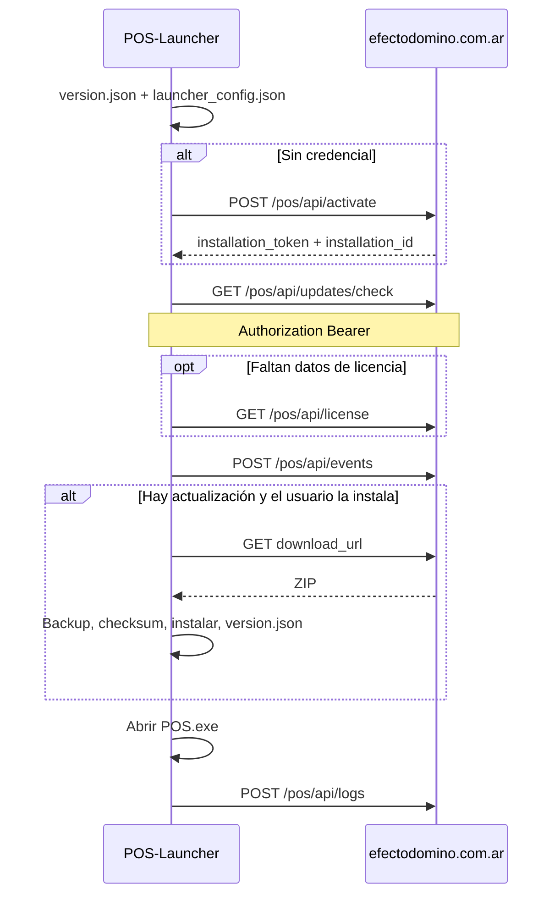

# Manual de actualizaciones del POS-Launcher

Cómo el Launcher identifica la instalación, consulta actualizaciones y aplica el ZIP del POS. El servidor es el de Efecto Dominó.

Código de referencia: `launcher/updater.py`, `launcher/resources/config.py`, `launcher/backup_manager.py`, `launcher/resources/exception_logging.py`.

## 1. Qué hace el Launcher al abrirse

1. Lee la versión instalada en `version.json`. Si no existe, no hay versión local.
2. Lee la credencial de `launcher_config.json`.
3. Si no hay credencial, pide el código de activación y no consulta actualizaciones.
4. Si hay credencial, consulta si hay una versión nueva y si esta instalación puede actualizar.
5. Si no hay actualización, la ventana espera 3 segundos y abre el POS.
6. Si hay actualización, el usuario puede descargarla o omitirla. Omitir abre el POS con la versión instalada.
7. Si el usuario cierra la ventana, el POS no se abre.
8. Al salir, envía al servidor el tramo nuevo de `launcher_errors.log`.

La base del POS (`sys_store.dat`) no viaja en el ZIP. Al instalar, se copia desde el backup local.

## 2. Servidor

Producción:

```text
https://www.efectodomino.com.ar
```

Para apuntar a otro entorno: variable `POS_WEB_API_BASE` (por ejemplo `http://localhost:8000`). El host tiene que ser de plataforma (`www.efectodomino.com.ar`, `efectodomino.com.ar` o `localhost`). No usar un dominio de tenant de Business Site.

| Uso | Método | Path |
|-----|--------|------|
| Activar con un código | `POST` | `/pos/api/activate` |
| ¿Hay update? | `GET` | `/pos/api/updates/check` |
| Descargar el ZIP | `GET` | `/pos/api/updates/download/{version}` |
| Estado de la licencia | `GET` | `/pos/api/license` |
| Avisar que se consultó | `POST` | `/pos/api/events` |
| Enviar errores del Launcher | `POST` | `/pos/api/logs` |

El prefijo `/pos/` es obligatorio. Los endpoints JSON no usan sesión ni CSRF. No se envían cookies.

Tiempos, en `launcher/resources/config.py`:

| Parámetro | Valor |
|-----------|--------|
| Check, licencia, activación y evento | 5 s |
| Descarga del ZIP | 600 s, chunks de 32 KB |
| Reintentos de descarga | 3, con 3 s entre intentos |
| Envío del log | 15 s, hasta 256 KB del tramo nuevo |
| User-Agent | `POS-Launcher/<versión del launcher>` |

## 3. Credencial

La credencial vigente es el `installation_token` que devuelve la activación. Viaja en `Authorization: Bearer`. No va en la query string.

Si todavía no hay token, el Launcher usa el UUID legado de `PosCustomer`: primero `POS_CUSTOMER_UUID` y, si no está, `customer_uuid` dentro de `launcher_config.json`. En cuanto hay token, ese UUID deja de usarse como Bearer.

Cuando hay token e `installation_id`, también se envía:

```http
X-Pos-Installation-Id: <installation_id>
```

Ese id tiene que pertenecer a la misma instalación del token.

El archivo queda en `%LocalAppData%\NexoPOS\launcher_config.json`. Ahí se guardan `installation_token`, `installation_id` y, como caché, `edition` y `valid_until`. El código de activación no se guarda. El Bearer no se muestra en pantalla ni se escribe en el log.

Si falta la credencial, la ventana pide el código y se puede seguir con la versión instalada.

## 4. Activación

```http
POST /pos/api/activate HTTP/1.1
Host: www.efectodomino.com.ar
User-Agent: POS-Launcher/0.1.0
Accept: application/json
Content-Type: application/json

{
  "code": "EL-CODIGO",
  "machine_id": "<sha256 del equipo>",
  "os": "windows",
  "launcher_version": "0.1.0"
}
```

Esta llamada no lleva `Authorization`. `machine_id` es el SHA-256 del `MachineGuid` de Windows. Si no se puede leer, se persiste un id local en el config. `os` vale `windows`, `macos` o `linux`.

Respuesta esperada: `installation_token`, `installation_id` y, si vienen, `edition` y `valid_until`. Sin token o sin id, la activación se considera fallida y no se escribe el config.

| Código | Qué ve el usuario |
|--------|-------------------|
| 400, 401, 404 | El código no es válido, está vencido o fue revocado |
| 409 | El código ya fue utilizado |
| 403 | El `detail` del servidor |
| timeout / DNS | No se pudo activar; se puede reintentar o seguir con la versión instalada |

El código se reemplaza por `***` si llegara a aparecer en un error.

## 5. Check

```http
GET /pos/api/updates/check?version=0.2.1&os=windows HTTP/1.1
Host: www.efectodomino.com.ar
Authorization: Bearer <installation_token>
User-Agent: POS-Launcher/0.1.0
Accept: application/json
```

`version` es la de `version.json`, sin prefijo `v`. Si no hay versión instalada, el query lleva solo `os`. El Launcher no elige el ZIP: el servidor lo elige según la edición y el sistema.

Sin actualización:

```json
{
  "update_available": false,
  "current_latest": "0.2.1"
}
```

Con actualización:

```json
{
  "update_available": true,
  "version": "0.3.0",
  "changelog": "- Mejoras y correcciones",
  "release_date": "2026-08-17",
  "file_size": 30050725,
  "download_url": "https://www.efectodomino.com.ar/pos/api/updates/download/0.3.0",
  "checksum": "sha256:948e8fbe520c7c5feb87e287ee4372af521cc1dcfe21c2ec6064f9b7a4422b35",
  "edition": "<texto del servidor>",
  "valid_until": "2027-08-17",
  "updates_allowed": true,
  "billing_status": "active",
  "message": ""
}
```

`edition`, `valid_until`, `updates_allowed`, `billing_status` y `message` pueden venir en la raíz o dentro de un objeto `license`. El Launcher se queda con `update_available` del servidor; no vuelve a comparar la versión por su cuenta.

| Campo | Uso |
|-------|-----|
| `update_available` | Decidir si hay algo para instalar |
| `version` | Versión remota, ya sin `v` |
| `changelog` | Texto de la ventana. Si falta: «Sin descripción disponible» |
| `release_date` | Se muestra como `YYYY-MM-DD` |
| `file_size` | Progreso de la descarga |
| `download_url` | URL absoluta de la descarga. Si falta, se arma `/pos/api/updates/download/{version}` |
| `checksum` | `sha256:<hex>`. Puede venir vacío |
| `updates_allowed` | `false` bloquea la descarga |
| `billing_status` | `past_due` bloquea la descarga aunque `updates_allowed` hubiera venido en true |
| `message` | Texto del bloqueo. Si falta, se usa un mensaje genérico |
| `valid_until` | Se agrega al mensaje de bloqueo si todavía no está en el texto |

Si hay token y la respuesta no trae `updates_allowed` o `billing_status`, el Launcher hace `GET /pos/api/license` con los mismos headers. Si esa llamada falla, sigue con lo que ya tenía el check.

Después del check, y sin cortar el flujo si falla, avisa:

```http
POST /pos/api/events
```

```json
{
  "event": "update_check",
  "app_version": "0.2.1",
  "os": "windows"
}
```

`edition` y `valid_until` se guardan en `launcher_config.json`.

## 6. Descarga

Se usa `download_url` del check. El token no va dentro de esa URL: se repiten los headers de autorización, con `Accept: application/octet-stream` y `Accept-Encoding: identity`.

```http
GET /pos/api/updates/download/0.3.0 HTTP/1.1
Host: www.efectodomino.com.ar
Authorization: Bearer <installation_token>
User-Agent: POS-Launcher/0.1.0
Accept: application/octet-stream
Accept-Encoding: identity
```

La respuesta 200 es el ZIP de la app POS. Puede traer `Content-Length`, `Content-Disposition` y `X-Checksum-SHA256`. El nombre de `Content-Disposition` es el nombre con el que se guarda el archivo. El header de checksum, si no trae el prefijo, se normaliza a `sha256:<hex>`.

El archivo va a `%TEMP%\POS_Updates\`.

Si hay checksum (el del check o el del header):

1. Se calcula el SHA-256 del archivo.
2. Se compara el hex.
3. Si no coincide, se borra y se reintenta. Al agotar los 3 intentos, no se instala.

Si el checksum viene vacío, la descarga se acepta igual.

401, 403 y 404 no se reintentan. El resto de los fallos de descarga sí, hasta 3 veces.

## 7. Instalación local

Si ya hay una versión instalada, antes de bajar se copia el árbol de `%LocalAppData%\NexoPOS` a `backup\` (sin copiar `backup` dentro de sí mismo). Se vuelve a crear ese backup justo antes de instalar.

Al aplicar:

1. Si `POS.exe` está abierto, se lo cierra.
2. El ZIP se mueve a la carpeta de NexoPOS, se descomprime y se borra.
3. La carpeta extraída pasa a llamarse `POS`.
4. En Windows, `POS_Windows.exe` pasa a llamarse `POS.exe`.
5. `sys_store.dat` y, si existen, sus archivos `-journal`, `-wal` y `-shm` se copian desde `backup\POS` hacia `POS`. El backup no se mueve ni se borra.
6. Se reescribe `%LocalAppData%\NexoPOS\version.json` con `version`, `app_name` (`POS`) y `updated_at`.

Si la instalación falla y el backup de ese intento se había creado, se restaura la versión anterior. El usuario también puede restaurarla a mano cuando no hay una actualización pendiente: en ese caso el POS se abre al terminar la restauración.

Después de una instalación correcta, la ventana espera un momento y abre el POS.

## 8. Apertura del POS

`start_application()` lanza un solo `POS.exe`, separado del Launcher. stdout y stderr van a `%LocalAppData%\NexoPOS\Launcher\logs\pos_startup.log`, que se vacía en cada arranque.

Durante 5 segundos el Launcher mira si ese proceso sigue vivo:

- Si termina, el código de salida y el texto del log quedan en `launcher_errors.log`.
- Si sigue abierto, se registra el PID y esa instancia es la que queda.

## 9. Errores del check

El cuerpo de error es `{ "detail": "..." }`. El Bearer no se muestra.

| Situación | Qué hace el Launcher |
|-----------|----------------------|
| 200 y `update_available: false` | Cuenta 3 segundos y abre el POS |
| 200 y actualización bloqueada por licencia o deuda | Título «Actualizaciones no disponibles» y el mensaje del servidor. Se puede seguir con la versión instalada |
| 401 | Pide de nuevo el código de activación. No descarga |
| 403 | Cuenta inactiva. Se puede seguir con la versión instalada |
| 404 | No hay actualización en el servidor. Se puede seguir |
| 400 u otro 4xx/5xx | Muestra el detalle y permite reintentar o seguir |
| timeout / DNS | Avisa que no hubo conexión. Permite reintentar o seguir |
| Excepción inesperada | Queda en `launcher_errors.log`. Permite reintentar o seguir |

## 10. Envío del log

Al cerrar, si hay texto nuevo desde el último envío, hace `POST /pos/api/logs` con la misma credencial:

```json
{
  "usuario": "<cuenta de Windows>",
  "ip": "<IP local>",
  "pos_version": "0.2.1",
  "launcher_version": "0.1.0",
  "log": "<tramo nuevo de launcher_errors.log>"
}
```

El archivo local no se borra. No se envían la base ni los registros del POS. Si no hay credencial o el envío falla, el Launcher igual termina.

El archivo está en `%LocalAppData%\NexoPOS\Launcher\logs\launcher_errors.log`.

## 11. Archivos en la PC

| Ruta | Rol |
|------|-----|
| `%LocalAppData%\NexoPOS\version.json` | Versión instalada del POS |
| `%LocalAppData%\NexoPOS\launcher_config.json` | Token, id de instalación y caché de licencia |
| `%LocalAppData%\NexoPOS\POS\POS.exe` | Ejecutable que abre el Launcher |
| `%LocalAppData%\NexoPOS\POS\sys_store.dat` | Base. No forma parte del ZIP |
| `%LocalAppData%\NexoPOS\backup\` | Copia para restaurar la versión anterior |
| `%TEMP%\POS_Updates\` | ZIP mientras se descarga |


